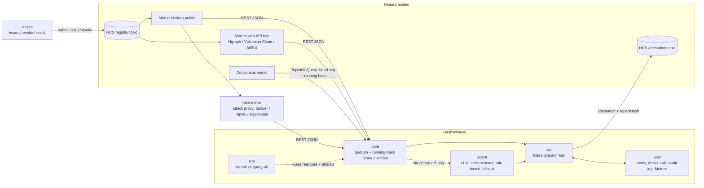

# HashWitness

**Verify Hedera data without trusting a single mirror node.** Hackathon proof of concept for the Hedera Cross Campus
Challenge 2026, on Hedera testnet.

## The problem

Hedera's consensus is trustworthy, but applications almost never talk to consensus nodes. They read through a
**mirror node REST API**, which returns plain JSON with no proof. One compromised or faulty mirror can:

- **tamper**: delete a credential revocation, or alter a message;
- **replay**: serve an old snapshot that predates the revocation;
- **equivocate**: show different clients different histories.

Use case: a school issues diploma credentials on the Hedera Consensus Service (HCS); a recruiter verifies them. If the
recruiter's app trusts one mirror, a revoked diploma can be shown as valid.

## What HashWitness does

1. **Quorum over mirrors**: queries N mirrors in parallel and compares their views of the registry topic.
2. **Local cryptographic check**: recomputes Hedera's SHA-384 **running-hash chain** for every message, so a mirror
   that edits or drops a message without re-forging the chain is caught.
3. **Consensus anchor**: reads the topic's latest sequence number and running hash **directly from a consensus node**
   (`TopicInfoQuery`). A mirror's history must end exactly at that hash. A forged chain, even a fully self-consistent
   one, cannot.
4. **Split-view probe**: re-queries each mirror as an anonymous client to catch equivocation.
5. **Attestation on HCS**: every verification publishes `{verdict, quorum, digest, reportHash}` to an attestation
   topic; anyone can re-hash the stored report and compare.
6. **AI forensic agent**: explains the attack and recommends an action. **The AI proposes, deterministic logic and
   cryptography decide**: the verdict never depends on the LLM.
7. **Adaptive mirror selection**: a Thompson-sampling bandit cuts query cost versus querying every mirror.

## Architecture



| Package | Role |
|---|---|
| `packages/core` | Mirror client (all mirror input validated as hostile), running-hash v3, quorum verifier, attestations. No SDK, no UI. |
| `packages/fake-mirror` | Malicious proxy in front of a real mirror. Deterministic, logged attack modes switchable at runtime. Lab use only. |
| `packages/agent` | Forensic agent: OpenAI-compatible API (default OpenRouter), strict JSON schema, 5 s timeout, one retry, cache, `DEMO_REPLAY`, rule-based fallback. |
| `packages/sim` | Seeded simulation: Thompson sampling vs query-all, using the real verifier and real attack transforms. |
| `apps/api` | Express API; the only place holding the Hedera operator key. |
| `apps/web` | Vite + React demo UI. All colors, fonts and motion in `theme.css`. |
| `scripts/` | Create topics, issue/revoke, verify (CLI), audit log, seed the demo. |

## How Hedera is used, and why

| Hedera feature | Used for | Why it matters |
|---|---|---|
| **HCS registry topic** (with submit key) | Credential lifecycle: `issue` / `revoke` messages | Ordered, timestamped, tamper-evident log; only the issuer can write. |
| **HCS running hash (v3)** | Recomputed locally for every message | Each message commits to the whole history. We reproduce the node's exact algorithm (SHA-384 over a Java serialization stream), checked on 100/100 real testnet messages. |
| **Consensus node query** (`TopicInfoQuery`) | Anchor: latest sequence number + running hash | Comes from consensus, not from a mirror, so a mirror cannot fake it. Turns "majority vote" into "provably correct". |
| **Mirror node REST API** | Reading messages, from several providers | What real apps use; HashWitness makes it verifiable. |
| **HCS attestation topic** | Public record of every verification and its report hash | Third parties can audit what was verified, when, and with which evidence. |

Measured costs on testnet: one attestation message ≈ **0.0053 ℏ (≈ $0.00034)** (HashScan, charged fee).

## Setup (testnet)

Requires Node 20+ and a free testnet account from https://portal.hedera.com/.

```bash
git clone https://github.com/manelell83/hashwitness.git && cd hashwitness
npm install -g pnpm@10
pnpm install
cp .env.example .env        # then set OPERATOR_ID and OPERATOR_KEY
pnpm demo                   # seeds topics + registry + simulation, starts everything
```

Open http://localhost:5173. `pnpm demo` is idempotent; run it before every demo. Demo script: [`scripts/demo.md`](scripts/demo.md).

Optional in `.env`: `HGRAPH_API_KEY`, `VALIDATIONCLOUD_API_KEY`, `ARKHIA_API_KEY` (more real mirrors);
`LLM_API_KEY` + `LLM_MODEL` (live AI analysis; otherwise the rule-based fallback is used and labelled as such).

Other commands: `pnpm test` (unit + HTTP tests), `pnpm typecheck`, `pnpm verify DIP-001 --fake --k 1`,
`pnpm attack tamper|replay|equivocate|honest`, `pnpm audit-log`, `pnpm sim --seed 42 --scenarios 200`.

## Results

**Attacks on real testnet data** (registry `0.0.11443553`): with the consensus anchor, all three attacks are detected
and the verdict stays **Revoked**, while an app trusting the attacker mirror shows **Valid**. Tamper is flagged as
*Forged history*, replay as *Stale view*, equivocation as *Two-faced*. Details: [`NOTES.md`](NOTES.md) §9.

**Simulation** (`pnpm sim`, seed 42, 200 scenarios; parameters are **assumptions**, exported with the results):

| | Bandit | Query every mirror |
|---|---|---|
| Queries per verification | 3.00 | 9.89 |
| Cost units | 647 | 2 774 (bandit −77 %) |
| Accepted the attacker's lie | 0 % | 0 % |
| Attacker exposed | 43 % | 100 % |
| False positives (benign lag flagged) | 12 % | 24 % |

Rule-based classifier on query-all evidence: tamper, replay and equivocation 100 % correct; 33 of 140 benign
scenarios (mirror lag) labelled replay. Accuracy 84 %.

## Honest limitations

- **Real vs simulated mirrors.** Only **one** keyless public testnet mirror exists (`testnet.mirrornode.hedera.com`);
  the live demo uses it plus the **local attacker mirror**. Hgraph, Validation Cloud and Arkhia are supported but need
  free API keys; **none were configured during development**, and the Validation Cloud / Arkhia key format is
  unverified. We cannot prove from outside that providers run independent importers. The simulation's 5 mirrors are
  simulated.
- **Anchor trust.** The anchor comes from one consensus node via `TopicInfoQuery`. Querying several nodes would remove
  that single point. Without the anchor, a colluding majority of mirrors wins (tested and documented).
- **Equivocation** is caught only when the probe looks like a different client to the mirror. A mirror that splits
  views by IP address would need probes from other network locations.
- **Lag vs replay** cannot be told apart in a single verification; benign lag is the source of all false positives.
- **AI agent:** the live LLM path is unit-tested against a mocked API but **was not run against OpenRouter** (no key
  configured). No `DEMO_REPLAY` recordings exist yet, so replay mode falls back to the rule-based classifier,
  labelled as such. Recordings are only ever copied from real LLM runs (`pnpm agent:record`).
- **Simulation figures** depend on assumed parameters (costs, failure and attack rates); they are not measurements of
  real Hedera mirrors.
- **Credential model** is minimal: a SHA-256 of a JSON document, issuer = Hedera account. No W3C Verifiable
  Credentials, DIDs or holder signatures. Reports are stored locally only.
- **PoC hardening:** testnet only; the fake mirror's admin endpoint and the API have no authentication and bind to
  localhost; no rate limiting; the running-hash implementation is verified empirically, not formally.

## Design

Visual identity follows [`docs/DESIGN_BRIEF.md`](docs/DESIGN_BRIEF.md): all tokens in `apps/web/src/theme.css`; verdicts always icon + word + color;
three motion moments only; reduced motion respected. Places that need a design decision are marked `// DESIGN:` in
the code.
