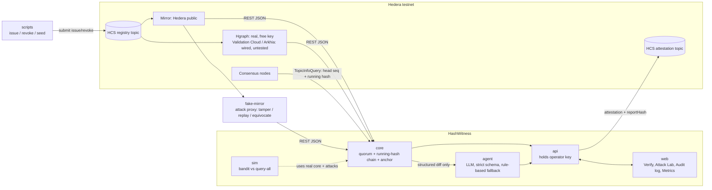

# HashWitness

**Verify Hedera data without trusting a single mirror node.** Hackathon proof of concept for the Hedera Cross Campus
Challenge 2026, on Hedera testnet.

## The problem

Hedera's consensus is trustworthy, but applications almost never talk to consensus nodes. They read through a
**mirror node REST API**, which returns plain JSON with no proof. One compromised or faulty mirror can:

- **tamper**: delete a credential revocation, or alter a message;
- **replay**: serve an old snapshot that predates the revocation;
- **equivocate**: show different clients different histories.

Use case: a school issues diploma credentials on the Hedera Consensus Service (HCS); a recruiter verifies them. If the
recruiter's app trusts one mirror, a revoked diploma can be shown as valid.

## What HashWitness does

1. **Quorum over mirrors**: queries N mirrors in parallel and compares their views of the registry topic.
2. **Local cryptographic check**: recomputes Hedera's SHA-384 **running-hash chain** for every message, so a mirror
   that edits or drops a message without re-forging the chain is caught.
3. **Consensus anchor**: reads the topic's latest sequence number and running hash **directly from a consensus node**
   (`TopicInfoQuery`). A mirror's history must end exactly at that hash. A forged chain, even a fully self-consistent
   one, cannot.
4. **Split-view probe**: re-queries each mirror as an anonymous client to catch equivocation.
5. **Attestation on HCS**: every verification publishes `{verdict, quorum, digest, reportHash}` to an attestation
   topic; anyone can re-hash the stored report and compare.
6. **AI forensic agent**: explains the attack and recommends an action. **The AI proposes, deterministic logic and
   cryptography decide**: the verdict never depends on the LLM.
7. **Adaptive mirror selection**: a Thompson-sampling bandit cuts query cost versus querying every mirror.

## Architecture



| Package | Role |
|---|---|
| `packages/core` | Mirror client (all mirror input validated as hostile), running-hash v3, quorum verifier, attestations. No SDK, no UI. |
| `packages/fake-mirror` | Malicious proxy in front of a real mirror. Deterministic, logged attack modes switchable at runtime. Lab use only. |
| `packages/agent` | Forensic agent: OpenAI-compatible API (default OpenRouter), strict JSON schema, 5 s timeout, one retry, cache, `DEMO_REPLAY`, rule-based fallback. |
| `packages/sim` | Seeded simulation: Thompson sampling vs query-all, using the real verifier and real attack transforms. |
| `apps/api` | Express API; the only place holding the Hedera operator key. |
| `apps/web` | Vite + React demo UI. All colors, fonts and motion in `theme.css`. |
| `scripts/` | Create topics, issue/revoke, verify (CLI), audit log, seed the demo. |

## How Hedera is used, and why

| Hedera feature | Used for | Why it matters |
|---|---|---|
| **HCS registry topic** (with submit key) | Credential lifecycle: `issue` / `revoke` messages | Ordered, timestamped, tamper-evident log; only the issuer can write. |
| **HCS running hash (v3)** | Recomputed locally for every message | Each message commits to the whole history. We reproduce the node's exact algorithm (SHA-384 over a Java serialization stream), checked on 100/100 real testnet messages. |
| **Consensus node query** (`TopicInfoQuery`) | Anchor: latest sequence number + running hash | Comes from consensus, not from a mirror, so a mirror cannot fake it. Turns "majority vote" into "provably correct". |
| **Mirror node REST API** | Reading messages, from several providers | What real apps use; HashWitness makes it verifiable. |
| **HCS attestation topic** | Public record of every verification and its report hash | Third parties can audit what was verified, when, and with which evidence. |

Measured costs on testnet: one attestation message ≈ **0.0053 ℏ (≈ $0.00034)** (HashScan, charged fee).

## Setup (testnet)

Requires Node 20+ and a free testnet account from https://portal.hedera.com/.

```bash
git clone https://github.com/manelell83/hashwitness.git && cd hashwitness
npm install -g pnpm@10
pnpm install
cp .env.example .env        # then set OPERATOR_ID and OPERATOR_KEY
pnpm demo                   # seeds topics + registry + simulation + offline cache, prints URLs, starts everything
```

Open http://localhost:5173. `pnpm demo` is idempotent; run it before every demo. Demo script: [`scripts/demo.md`](scripts/demo.md).

**Offline backup:** after one online `pnpm demo`, `pnpm demo:offline` runs with no network at all: mirror responses
and the consensus anchor come from the cache, AI answers from `demo-replay/` (real recorded LLM outputs), nothing is
published, and a banner says so. All checks, including the attacks, still run for real on that data.

Optional in `.env`: `HGRAPH_API_KEY` (second real mirror, free key), `VALIDATIONCLOUD_API_KEY`, `ARKHIA_API_KEY`,
or any provider via `MIRROR_n_URL` / `MIRROR_n_KEY`; `LLM_API_KEY` + `LLM_MODEL` + `LLM_MAX_TOKENS` (live AI
analysis; otherwise the rule-based fallback answers and the UI labels it).

Other commands: `pnpm test` (unit + HTTP tests), `pnpm typecheck`, `pnpm mirrors:check` (one real request per mirror),
`pnpm llm:probe <model>` (one real LLM call per attack), `pnpm verify DIP-001 --fake --k 1`,
`pnpm attack tamper|replay|equivocate|honest`, `pnpm audit-log`, `pnpm sim --seed 42 --scenarios 200`,
`pnpm sim:llm` (AI confusion matrix on 40 scenarios, then records the answers).

## Results

**Attacks on real testnet data** (registry `0.0.11443553`): with the consensus anchor, all three attacks are detected
and the verdict stays **Revoked**, while an app trusting the attacker mirror shows **Valid**. Tamper is flagged as
*Forged history*, replay as *Stale view*, equivocation as *Two-faced*. Details: [`NOTES.md`](NOTES.md) §9.

**Simulation** (`pnpm sim`, seed 42, 200 scenarios; parameters are **assumptions**, exported with the results):

| | Bandit | Query every mirror |
|---|---|---|
| Queries per verification | 3.00 | 9.89 |
| Cost units | 647 | 2 774 (bandit −77 %) |
| Accepted the attacker's lie | 0 % | 0 % |
| Attacker exposed | 43 % | 100 % |
| False positives (benign lag flagged) | 12 % | 24 % |

Rule-based classifier on query-all evidence: tamper, replay and equivocation 100 % correct; 33 of 140 benign
scenarios (mirror lag) labelled replay. Accuracy 84 %.

**AI agent** (`pnpm sim:llm`, `openai/gpt-oss-20b`, first 40 scenarios, 0 fallbacks): tamper 5/5, replay 7/7,
equivocation 6/6, benign 15/22 (7 lag cases labelled replay). Accuracy 83 %, identical to the rules on the same
scenarios. Total OpenRouter spend for all model tests, live demo runs and this evaluation: **$0.0057** (measured).

## Known limitations

In short: **real** = Hedera testnet, the consensus-node anchor, the Hedera public mirror, Hgraph, and the LLM calls;
**simulated** = the attacker mirror (a local proxy that lies on purpose) and the 5 mirrors of the cost simulation;
**not done** = verifying mirror data against signed record files / state proofs.


- **Real vs simulated mirrors.** The live demo uses **two real testnet mirrors**, the keyless Hedera public mirror
  (`testnet.mirrornode.hedera.com`) and **Hgraph** (free API key), plus **one local attacker mirror** (a proxy in front
  of the public mirror). Both real mirrors were checked with `pnpm mirrors:check`: same chain, ending at the consensus
  anchor. Validation Cloud and Arkhia are wired in but **untested** (no working testnet key; their key format is
  unverified). Without `HGRAPH_API_KEY`, the demo runs on one real mirror plus the attacker. We cannot prove from
  outside that providers run independent importers. The simulation's 5 mirrors are simulated.
- **Anchor trust.** The anchor comes from one consensus node via `TopicInfoQuery`. Querying several nodes would remove
  that single point. Without the anchor, a colluding majority of mirrors wins (tested and documented).
- **Equivocation** is caught only when the probe looks like a different client to the mirror. A mirror that splits
  views by IP address would need probes from other network locations.
- **Lag vs replay** cannot be told apart in a single verification; benign lag is the source of all false positives.
- **AI agent:** runs live on OpenRouter with `openai/gpt-oss-20b` (chosen after testing 3 models; see NOTES.md §16).
  On the first 40 simulated scenarios it matches the rule-based classifier exactly, so it adds explanations, not
  accuracy; like the rules, it labels benign mirror lag as replay. A 5 s timeout and an invalid answer both fall back to
  the rules, and the UI says which engine answered. `demo-replay/` holds real recorded answers for the 3 demo attacks
  and the simulation (`DEMO_REPLAY=1`); recordings are only ever copied from real runs (`pnpm agent:record`).
- **Simulation figures** depend on assumed parameters (costs, failure and attack rates); they are not measurements of
  real Hedera mirrors.
- **Credential model** is minimal: a SHA-256 of a JSON document, issuer = Hedera account. No W3C Verifiable
  Credentials, DIDs or holder signatures. Reports are stored locally only.
- **PoC hardening:** testnet only; the fake mirror's admin endpoint and the API have no authentication and bind to
  localhost; no rate limiting; the running-hash implementation is verified empirically, not formally.
- **Future work: record-file signature verification.** HashWitness trusts the consensus node it queries for the anchor
  and checks mirror data against it. It does not yet verify consensus nodes' signatures on record files (or state
  proofs), which would make a single mirror's answer verifiable on its own, without a quorum or a live node query.
- **Offline mode** (`pnpm demo:offline`) replays data cached during the last online run: it shows how the checks work,
  not the current state of the ledger, and it publishes nothing. The UI says so with a banner.

## Design

Visual identity follows [`docs/DESIGN_BRIEF.md`](docs/DESIGN_BRIEF.md): all tokens in `apps/web/src/theme.css`; verdicts always icon + word + color;
three motion moments only; reduced motion respected. Places that need a design decision are marked `// DESIGN:` in
the code.
